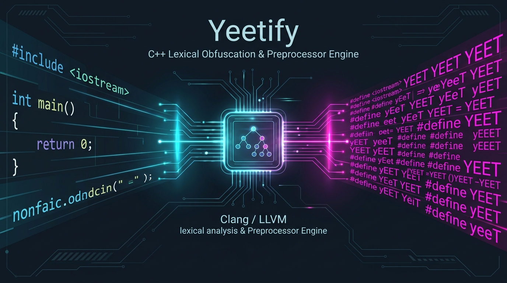
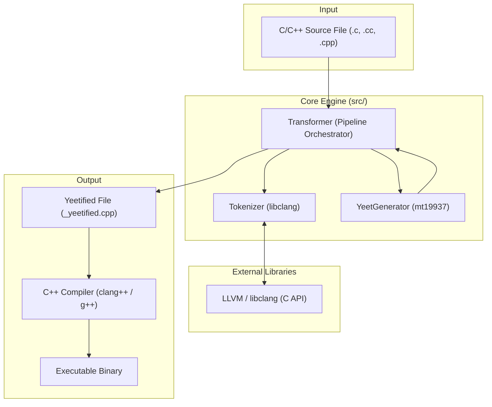
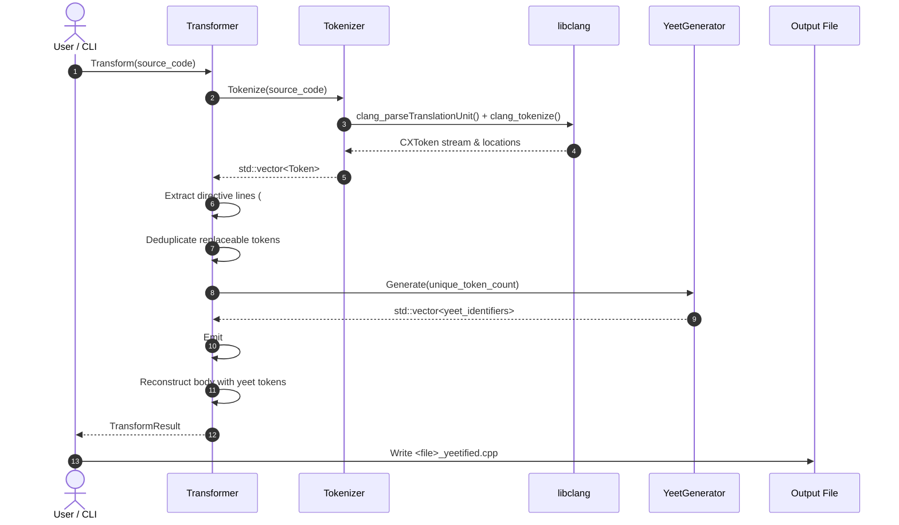
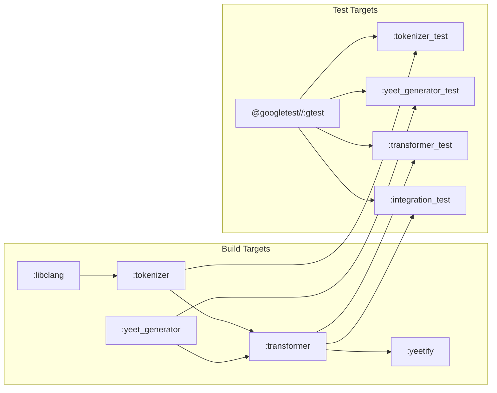

# Yeetify Architecture & Technical Design



This document provides a comprehensive overview of the system architecture, design patterns, and processing pipeline for **Yeetify**—a C/C++ source-to-source obfuscation and preprocessor transformation utility.

---

## 1. High-Level Architecture Overview

Yeetify transforms C and C++ source code into syntactically valid, compilable code where all language tokens are rewritten as permutations of the word `"yeet"`, prepended with C preprocessor `#define` directives.



---

## 2. Component Design & Responsibilities

The codebase is organized into modular components adhering to the Single Responsibility Principle:

```
src/
├── tokenizer.h / .cpp       # Outsources lexing to LLVM libclang
├── yeet_generator.h / .cpp  # Deterministic, collision-resistant identifier generator
├── transformer.h / .cpp     # Pipeline orchestrator and macro emission
└── main.cpp                 # Command-line interface and argument parsing
```

### 2.1 Tokenizer (`yeetify::Tokenizer`)
* **Role**: Decomposes raw C/C++ source into structured language tokens using LLVM's `libclang` C API (`clang_tokenize`).
* **Implementation Details**:
  * Utilizes `CXUnsavedFile` to parse in-memory buffers without requiring disk writes.
  * Informs the Clang frontend of language flags (`-std=c++17`, `-x c++`, `-Wno-everything`).
  * Emits typed tokens:
    * `TokenType::Keyword` (`int`, `return`, `class`, `for`)
    * `TokenType::Identifier` (`main`, `std`, `cout`, variables)
    * `TokenType::Literal` (string literals with spaces like `"Hello, World!"`, numbers, character literals)
    * `TokenType::Punctuation` (`::`, `<<`, `++`, `->`, `{`, `}`, `;`)
    * `TokenType::Comment` (`//`, `/* ... */`)
  * **Directive Detection**: Distinguishes preprocessor directive lines (`#include`, `#define`, `#pragma`, line continuations `\`) from regular code lines.

### 2.2 YeetGenerator (`yeetify::YeetGenerator`)
* **Role**: Generates $N$ distinct, valid C++ identifiers conforming to the regex `[yY][eE]+[tT]+`.
* **Implementation Details**:
  * Powered by `std::mt19937` with an explicit or time-based seed, enabling deterministic and reproducible transformations for testing.
  * **Collision Mitigation**: Dynamically scales the parameter space ($e$ and $t$ repetition bounds) when collision density increases, preventing infinite loops and guaranteeing completion for arbitrary token counts $N \ge 0$.
  * Eliminates legacy edge-case crashes (such as division-by-zero when $N \le 1$).

### 2.3 Transformer (`yeetify::Transformer`)
* **Role**: Orchestrates the transformation lifecycle and generates the final C/C++ source code.
* **Pipeline**:
  1. Requests tokens from `Tokenizer`.
  2. Extracts and preserves directive lines (`#include`, `#define`) at the file header.
  3. Deduplicates replaceable code tokens (keywords, identifiers, literals, operators).
  4. Requests $N$ unique yeet identifiers from `YeetGenerator`.
  5. Generates macro definitions: `#define <yeet_perm> <original_token>`.
  6. Reconstructs the source body, mapping tokens to their yeet counterparts while preserving line breaks and comments.

### 2.4 CLI Entry Point (`src/main.cpp`)
* Provides standard CLI argument parsing:
  ```bash
  yeetify <source_file> [-o <output_file>] [--seed <number>]
  ```
* Enforces file extension validation (`.c`, `.cc`, `.cpp`, `.cxx`, `.h`, `.hpp`).
* Handles file I/O streams and displays conversion metrics.

---

## 3. Data Flow & Processing Lifecycle



---

## 4. Preprocessor Expansion & Compilation Invariants

The transformation relies on the C Preprocessor (CPP) phase:

```
[Original Source] -> [Token Replacement] -> [Macro Expansion] -> [Compilation]
```

1. **Include Invariant**: Standard library `#include` directives are emitted **before** generated `#define` macros. This guarantees that headers (`<iostream>`, `<vector>`) parse without accidental macro replacement collisions.
2. **Token Replacement Invariant**: In C/C++, macro identifiers can replace any preprocessor token (punctuation, keywords, string literals).
   * Example: `#define yE "Yeet!"` expands `yE` to `"Yeet!"`.
   * Example: `#define yET ::` expands `yET` to `::`.
   * Example: `#define yEtt <<` expands `yEtt` to `<<`.
3. **Comment & Whitespace Invariant**: Comments are preserved intact, and newline structures are maintained, keeping the source layout inspectable.

---

## 5. Build & Test Architecture

Built with **Bazel 8 (Bzlmod)** for hermetic, reproducible builds:



### Test Strategy
* **Unit Tests**:
  * `//:tokenizer_test`: Lexing string literals with spaces, operators without whitespace, comments, multiline directives.
  * `//:yeet_generator_test`: Distribution, regex conformance, collision resilience, seed determinism.
  * `//:transformer_test`: Directive placement, mapping integrity, macro output syntax.
* **Integration Tests**:
  * `//:integration_test`: End-to-end integration test that takes C++ programs, yeetifies them, invokes the host `clang++` compiler on the output, executes the generated binary, and verifies exit code and stdout.
